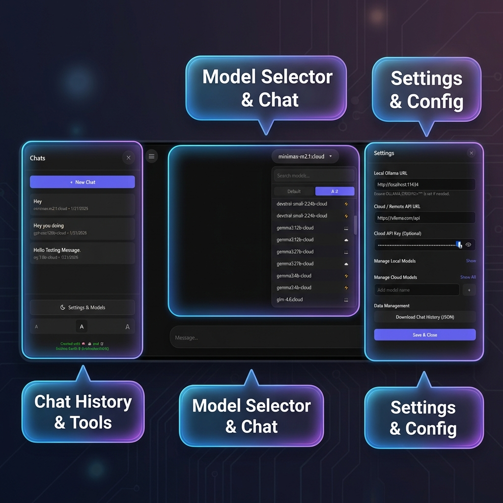

# Ollama Web App

[](https://www.gnu.org/licenses/gpl-3.0)

A lightweight, secure, and independent web application for chatting with Ollama models (Local and Cloud).



### Highlights
1.  **Sidebar (Left)**: Organize your chats, delete old threads, or download them as Markdown. Resizable for your convenience.
2.  **Model Selector (Center)**: Free cloud models are listed first, followed by local models and then paid cloud models, each as a separate section with a count. Supports "Thinking", "Tools", and power indicators.
3.  **Settings Panel (Right)**: Configure API endpoints, manage hidden models, and export your entire database.

## Documentation
- [**Code Documentation**](CODE_DOCUMENTATION.md): High-level architecture and code overview.
- [**Design Philosophy**](DESIGN_PHILOSOPHY.md): Why we built it this way.
- [**Contributing**](CONTRIBUTING.md): How to help improve the project.

## Features
- **PWA Support**: Installable as a standalone desktop app.
- **Platform Independent**: Works on Desktop, Tablet, and Mobile.
- **Secure**: All data (API Keys, Chat History) is stored locally in your browser (IndexedDB & LocalStorage). No server-side persistence.
- **Local & Cloud Support**: Connect to your local Ollama instance or valid Cloud API endpoints.
- **Chat History**: Full history saved locally with export capability.
- **Settings**: Manage models, API keys, and endpoints directly from the UI.

## How to Run

### Method 1: Automated Launcher (Recommended)
Double-click the launcher script for your OS. It will automatically install a lightweight local server and open the app in your browser.

- **Windows**: Double-click `run_app.bat`
- **Linux/Mac**: Run `./run_app.sh` (You may need to `chmod +x run_app.sh` first)

### Method 2: Manual Start
If you prefer to run it manually using Node.js:
```bash
npm install
npm start
```

### Configuring Local Ollama
To allow the web app to communicate with your local Ollama instance, you must set the `OLLAMA_ORIGINS` environment variable to allow the request.

**Windows (PowerShell):**
```powershell
$env:OLLAMA_ORIGINS="*"; ollama serve
```

**Mac/Linux:**
```bash
OLLAMA_ORIGINS="*" ollama serve
```

## Dependencies
This project uses the following libraries, vendored locally in `vendor/` so the
app works offline (see `THIRD_PARTY_NOTICES.md`):
- [Marked](https://github.com/markedjs/marked) (Markdown parsing)
- [DOMPurify](https://github.com/cure53/DOMPurify) (Security sanitization)

## License
Copyright (C) 2026 Krishna Kanth B.
Licensed under the GNU General Public License v3.
